# WebFlipper 構成図

WebFlipperの構成をC4モデルで記録する。図は「現在ローカルで動く構成」と「ADR 0005で決定した本番目標構成」を明確に分ける。

## 図の一覧

| 図 | 対象 | 状態 |
| --- | --- | --- |
| [1ページ構成概要](./overview.md) | 本番目標構成と実装状況 | 概要 |
| [C4 Level 1: システムコンテキスト](./c4-context.md) | 利用者と外部システム | 製品仕様 |
| [C4 Level 2: 本番コンテナ](./c4-containers.md) | Cloudflare上の論理構成 | 目標構成 |
| [C4 Level 3: ルーム実行基盤](./c4-components-room-runtime.md) | RoomEngineとCloudflare Adapterの境界 | 一部実装済み |
| [本番デプロイ](./c4-deployment.md) | Cloudflareへの配置 | 目標構成 |
| [ローカル開発構成](./c4-local-development.md) | Windowsで現在動く構成 | 実装済み |

## 状態の読み方

- **実装済み**: 現在のリポジトリに実行可能なImplementationがある。
- **一部実装済み**: `RoomEngine`など中核はあるが、Cloudflare Adapterが未実装。
- **目標構成**: Acceptedな[ADR 0005](../ADR/0005-cloudflare-native-runtime.md)で決定済みだが、現在のコードには未実装部分がある。

## 現在との差分

現在の`apps/web/worker/index.js`はWorkers Static AssetsのSPAフォールバックだけを提供する。次の本番要素は後続実装で追加する。

- HTTP API・Cookieセッション・入力制限を担うCloudflare Worker
- 1ルーム1インスタンスのSQLite-backed Durable Object
- WebSocket HibernationとDurable Object Alarm
- Canvas描画操作履歴・PNGを保存するR2 Adapter
- Discord OAuth `identify` Adapter

## 最初に見る図

