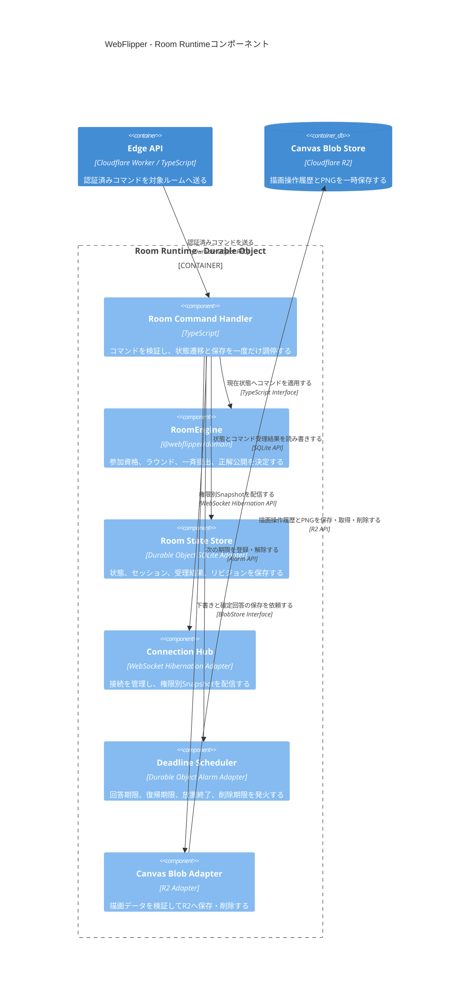

# C4 Level 3: ルーム実行基盤

Room Runtime内で、Cloudflare固有処理を深い`RoomEngine` Moduleの外側へ閉じ込める構成を示す。`RoomEngine`は実装済みで、その他のCloudflare Adapterは目標構成である。

## テスト境界

通常のTDDではCloudflareへ接続しない。`Room State Store`、`Connection Hub`、`Deadline Scheduler`、`Canvas Blob Adapter`をインメモリFakeへ交換し、公開Interfaceから状態、イベント、期限、エラーを検証する。

