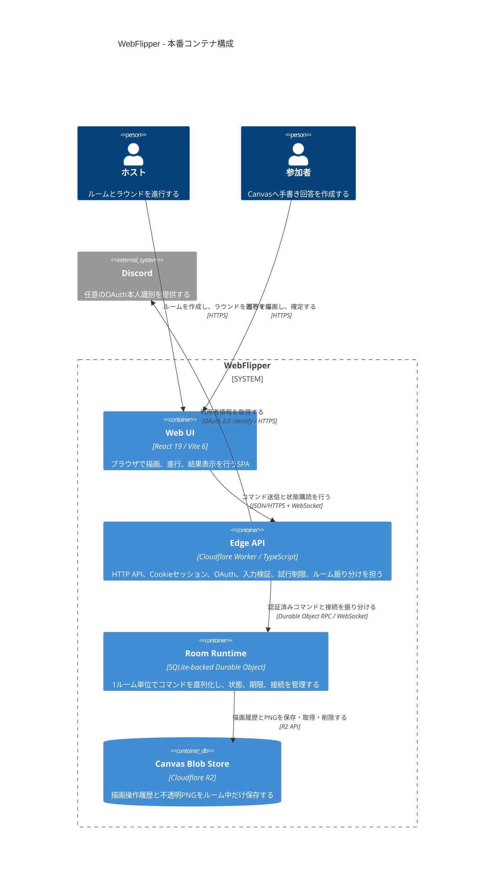

# C4 Level 2: 本番コンテナ

[ADR 0005](../ADR/0005-cloudflare-native-runtime.md)で決定したCloudflareネイティブの論理構成を示す。この図は目標構成であり、Cloudflare API・Durable Object・R2・Discord OAuth Adapterは未実装である。

## 責務分担

- Web UIは残り時間を表示するが、ラウンド終了や全員確定を独自判断しない。
- Edge APIは外部入力と本人識別を扱い、ルームの進行規則を持たない。
- Room Runtimeがルーム状態と期限の唯一の正となる。
- R2にはCanvasの大きなデータだけを置き、Durable Objectには参照と小さなメタデータを保持する。
- D1、KV、PostgreSQL、Valkey、常設VM、Cloudflare ContainersはMVP構成に含めない。

