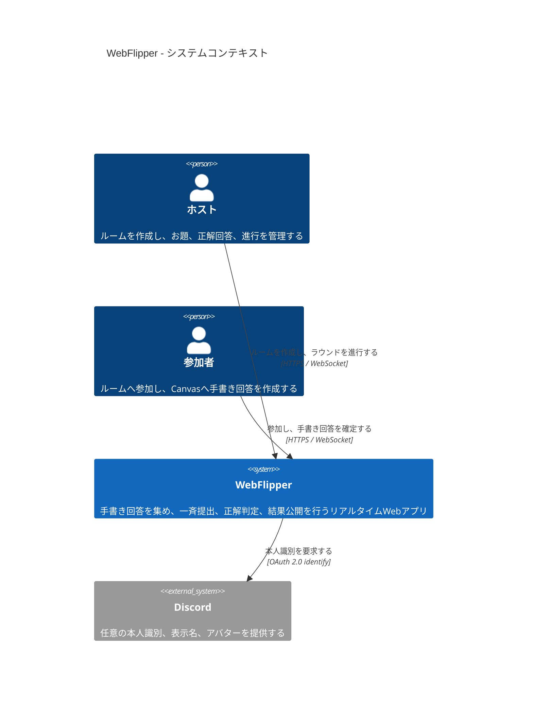

# C4 Level 1: システムコンテキスト

ホストと参加者から見たWebFlipperの責務、および唯一の外部サービスであるDiscordとの境界を示す。

## 境界

- ルームコードは参加先を特定する識別子であり、秘密情報ではない。
- ホスト・参加者の操作権はWebFlipper側のHttpOnly Cookieセッションで管理する。
- Discord連携は任意で、匿名参加も許可する。
- Discordは外部システムとして扱い、内部構造は図に含めない。

