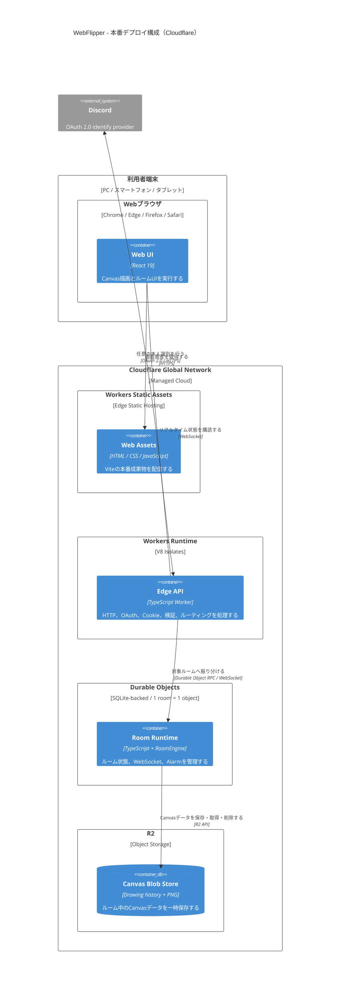

# 本番デプロイ構成

一般公開MVPをCloudflareへ配置する目標構成を示す。Workers Paidプランを前提とするが、常設VMや外部データベースは持たない。

## 運用上の性質

- WebSocketがアイドル中はHibernationを使い、常時実行時間を抑える。
- Durable Object Alarmが回答期限、5分のホスト復帰期限、2時間の放置終了、終了後データ削除を扱う。
- ルーム終了または次ラウンド移行時に、不要なR2オブジェクトを明示的に削除する。
- ログへお題、参加者名、Canvas、Discordアクセストークン、Cookie秘密情報を記録しない。

