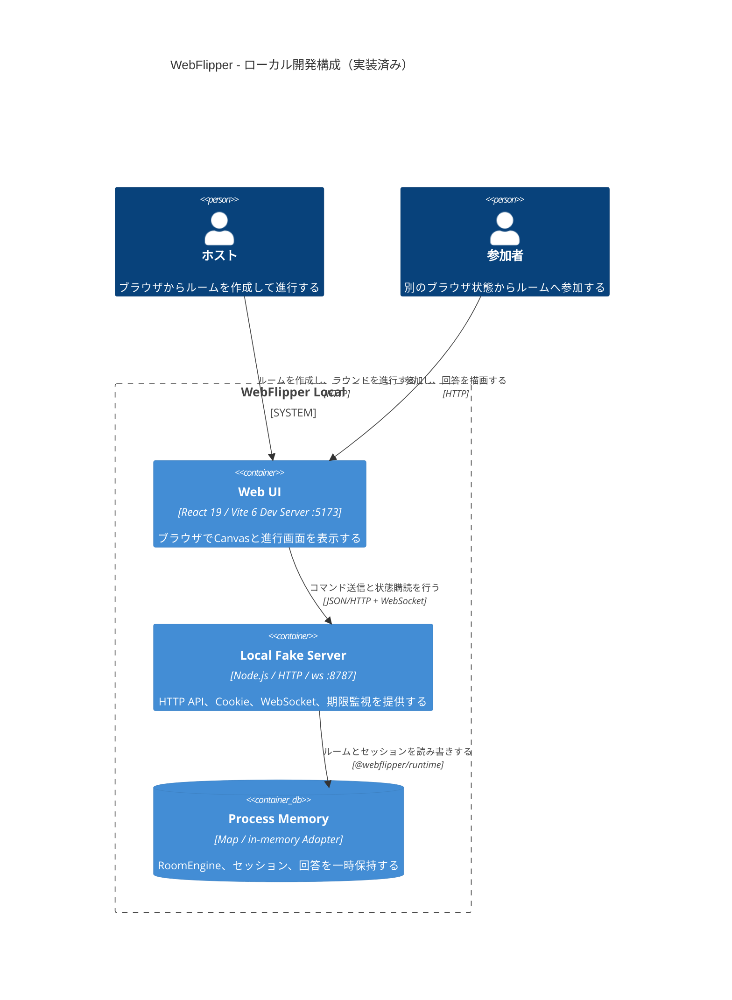

# ローカル開発構成

Windows上で現在実装済みの構成を示す。CloudflareサービスやDiscordへ接続せず、プロセス終了時にルーム状態も失われる。

## 実装対応

- `apps/web`: Web UI
- `apps/local-server`: Local Fake Server
- `packages/runtime`: インメモリRoom Service Adapter
- `packages/domain`: `RoomEngine`
- `packages/canvas`: 描画操作履歴とUndo・Redo

